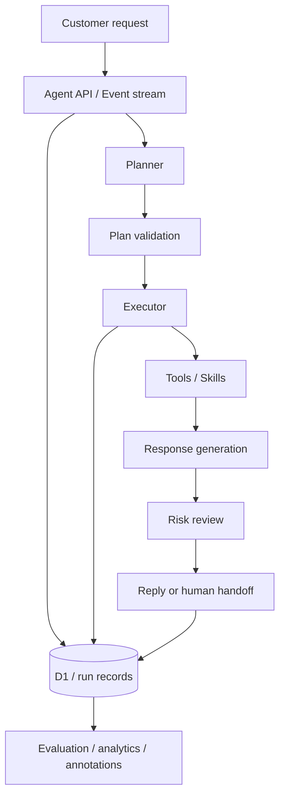

# SnackFlow | AI Customer Service Agent Studio

> An AI customer service workbench for snack retail, exploring agent orchestration, tool calling, observable execution and evaluation.
>
> 面向零食电商场景的 AI 客服 Agent 实验项目：从业务交互延伸到任务规划、工具调用、运行追踪及自动化评测。

**Project type:** AI application / Agent engineering / Evaluation  
**Status:** Prototype · v5 source snapshot · selected local tests passed  
**Language:** Chinese-first interface and sample data

[Validation notes](VALIDATION.md) · [Public-package review](PUBLIC_REVIEW.md)

## Overview | 项目简介

SnackFlow 以零食电商客服为业务场景，围绕商品推荐、优惠计算、订单及物流查询和风险提示等任务，探索一套可观察、可测试的 Agent 工作台。

除了用户侧交互页面，项目还包含 Planner、Tool/Skill 管理、运行记录、人工接管、评测用例及批量比较等模块。重点不仅是“生成一条回复”，而是让执行过程具有可追踪性、可验证性和调试入口。

## What is included | 核心模块

| Area | Implemented in this repository |
| --- | --- |
| Agent workbench | 客服交互、事件流输出、运行记录和执行过程查看 |
| Planner & execution | 任务规划、计划验证、工具与 Skill 选择及执行 |
| Business tools | 商品、活动、优惠券、订单、物流及价格计算的演示数据/工具 |
| Safety & handoff | 回复风险检查、异常处理及转人工流程 |
| Management | Tool/Skill 配置、Skill 测试、版本快照与回滚 |
| Evaluation | 用例管理、规则评分、批量评测、比较、标注和 CSV 导出 |
| Provider abstraction | 可重复运行的 fixture provider、Coze Coding SDK 配置入口、OpenAI-compatible 接口 |

### Architecture | 系统结构



*示意图概括仓库中的主要逻辑模块，不代表每个任务都会走过全部分支。*

## Evaluation-first development | 评测与迭代

项目提供确定性评测逻辑，用于检查回复内容与执行结果，例如：

- 是否调用必需的 Tools/Skills，以及是否误用了禁止调用的能力；
- 是否满足预期关键词、价格及回复约束；
- 是否出现不安全的转账、验证码等风险表达；
- 是否按预期返回结果、拦截或转人工；
- 批量执行、比较结果、错误定位和人工标注。

代码中如遇到要求 **LLM-as-a-Judge**、但 Judge Provider 尚未接通的用例，会标记为 `REVIEW`，不会伪造自动评分。这也是本项目保留可验证边界的一部分。

## Tech stack | 技术栈

- **Frontend:** TypeScript, React 19, Next.js 16 API conventions, Tailwind CSS 4
- **Runtime / build:** vinext, Vite 8, Cloudflare Workers
- **Database:** Cloudflare D1 / SQLite, Drizzle ORM
- **AI integration:** `coze-coding-dev-sdk`, OpenAI-compatible provider, deterministic fixture provider
- **Tests:** Node.js test runner, TypeScript checking, API integration tests

Dependency versions are recorded in [`package.json`](package.json) and [`pnpm-lock.yaml`](pnpm-lock.yaml).

## Run locally | 本地运行

**Requirements:** Node.js `>=22.13.0`, pnpm `11.9.0`. The reset unit tests also require the `sqlite3` CLI at `/usr/bin/sqlite3` (the original tests are macOS-oriented).

```bash
pnpm install --frozen-lockfile
cp .env.example .env
pnpm dev
```

Use `LLM_PROVIDER=classroom-fixture` for repeatable local demonstrations **without calling an external model**. Use the URL printed in your terminal.

```bash
pnpm typecheck
pnpm test:unit
pnpm build
node --test tests/rendered-html.test.mjs
```

For the API integration suite, start a local server first, then run:

```bash
SNACKOPS_BASE_URL=http://localhost:3000 pnpm test:api
```

The integration suite writes test records. **Do not point it at production.** See [`VALIDATION.md`](VALIDATION.md) for the source snapshot's recorded test results and scope.

## Providers & configuration | 模型与密钥

Real keys belong in a local, Git-ignored `.env` file or the hosting platform's secret storage; never commit them to this repository. The committed [`.env.example`](.env.example) intentionally contains empty secret fields.

- `classroom-fixture`: deterministic local provider; useful for demonstrations and tests.
- `coze`: existing Coze **Coding SDK** integration path. Requires a compatible workload identity key, integration service endpoints and model ID; a Coze Open Platform PAT alone is **not** proof of compatibility.
- `openai-compatible`: requires an appropriate API key, base URL and model configuration.

**Important limitation:** The v5 source snapshot's local fixture tests passed, but live Coze model/customer-service generation was **not verified** for this code snapshot because the matching Coze Coding integration endpoints and model were not available. A working UI or fixture-mode response should not be presented as proof of live LLM integration.

## Coze workflow backup | 工作流备份

No Coze workflow export was available in the reviewed v5 source. No workflow ZIP is included in this public package. The TypeScript Agent is the runtime implementation; v5 contains no verified adapter executing a Coze Chatflow directly. A separately supplied native export requires its own privacy review before inclusion.

Imported workflows may still require the original workspace's knowledge bases, database content, plugins, permissions and external credentials. Draft exports should not be assumed identical to a published online version.

## Verification & scope | 验证记录

The source snapshot was prepared without changing the live deployment. The recorded checks in [`VALIDATION.md`](VALIDATION.md) include:

- TypeScript checking and production build: passed;
- 26 unit tests and four route/source checks: passed;
- local API integration tests with isolated D1 and deterministic provider: passed;
- selected recommendation/price/risk evaluation cases: passed;
- live Coze generation: **not verified**.

The report reflects tests performed during source preparation, **not** a guarantee of current production availability or an independent security audit.

## Repository map | 目录结构

```text
app/            Pages, server APIs and demo business data
components/     Agent workbench and management interfaces
lib/agent/      Planner, executor, provider, tool/skill logic
lib/eval/       Evaluation, scoring and batch comparison
db/             Database access and schema
drizzle/        Database migrations
worker/         Cloudflare Worker entry point
build/          Build integration
scripts/        Maintenance utilities
tests/          Unit and integration tests
public/         Static assets
```

## Project notes | 项目说明

### Local configuration and deployment boundary

The public `.openai/hosting.json` contains only logical local bindings (`d1: DB`, `r2: null`); the private production project ID has been removed. The build still stages this sanitized metadata and migrations. Local development uses an isolated D1 database; repositories initialize their tables and demo records. `pnpm start` serves the production build locally.

This archive does not include production database content, hosting credentials or a deployment target. Configure your own hosting resources and secret store before attempting deployment; the public package cannot publish to the original project. The legacy `/api/skill` route separately uses the blank `DEEPSEEK_API_KEY` / `LLM_BASE_URL` settings. This route is not a verified Coze integration.

The two orders in `app/data/orders.json` use the name “演示用户”; logistics use `SF-DEMO-240701`. They contain no recipient address, phone number or payment identifiers. Treat these as demo fixtures, not real order integrations. The social preview artwork is illustrative, not evidence of production inventory/price verification.

This is a learning and prototyping project developed with AI-assisted coding tools. The work includes scenario design, workflow/feature definition, iterative debugging and validation; source code should be read alongside the recorded testing limitations rather than treated as a fully verified production service.

该仓库以技术学习和原型验证为目的。项目中的 Agent 逻辑和测试框架展示了可复现的工程实现；Coze 平台工作流、真实插件服务及生产数据属于独立依赖，不因源码公开而自动提供。

**Privacy:** Do not add real order data, personal phone numbers, API tokens, secret files or customer conversations to the repository. Review the entire Git history before changing the repository from Private to Public.
